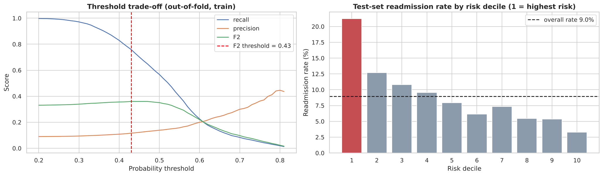
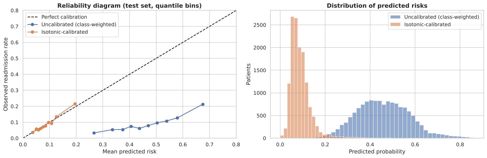
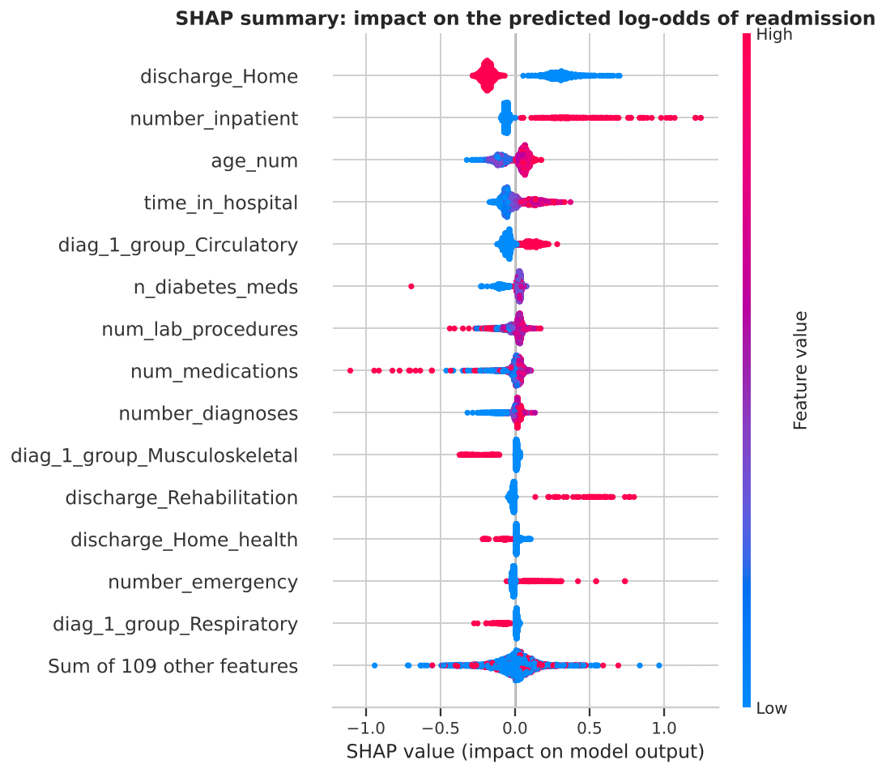
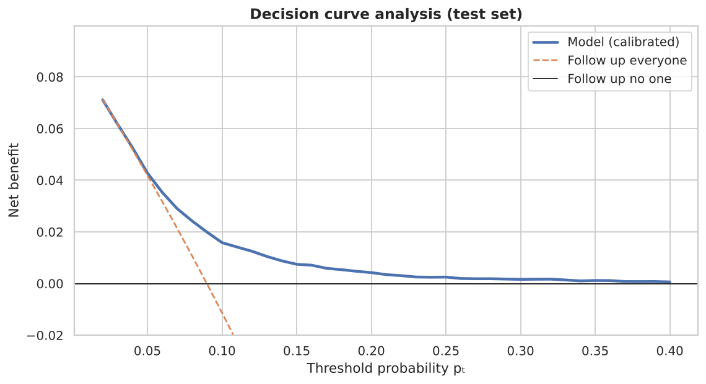

# Predicting 30-Day Hospital Readmission of Diabetic Patients

[](https://colab.research.google.com/github/YOUR_GITHUB_USERNAME/diabetes-readmission-prediction/blob/main/notebooks/diabetes_readmission_analysis.ipynb)


An end-to-end, **leakage-aware** machine learning study on **101,766 hospital encounters** from 130 US hospitals (UCI *Diabetes 130-US Hospitals, 1999–2008*). The goal: identify, **at discharge**, the diabetic patients most likely to be readmitted within 30 days, so that a hospital can focus low-cost follow-up where it matters.

Beyond a model comparison, the project treats the problem the way a clinical risk score should be treated: patient-level splitting, cross-validated model selection, **probability calibration**, **bootstrap confidence intervals**, **decision curve analysis**, **SHAP explanations**, a **subgroup fairness audit** and a **model card**.

## Key results

| | Result (held-out test set, 13,998 patients, 9.0 % readmitted) |
|---|---|
| **Discrimination** | ROC-AUC **0.653** (95 % CI 0.638–0.670) · PR-AUC **0.179** (2× the 0.090 chance level) |
| **Prioritisation** | The top 10 % risk decile has a **21.2 %** readmission rate — **2.4×** the average |
| **Recall-oriented threshold** | 74 % of readmissions caught (precision 0.12, 57 % of patients flagged) |
| **Capacity threshold (20 % followed up)** | 37.5 % of readmissions caught, precision 0.17 |
| **Calibration** | Mean predicted risk 45.9 % → **9.0 %** after isotonic calibration (observed 9.0 %); Brier 0.079 |
| **Clinical usefulness** | Positive net benefit vs "treat all" / "treat none" for threshold probabilities **3–40 %** |
| **Main drivers** | Discharge disposition and prior-year inpatient visits (permutation importance, SHAP, odds ratios agree) |
| **Fairness** | Recall 0.73–0.79 across sex and race; 0.57 (< 60) to 0.89 (80+) across age with a single threshold |

Two side analyses:
- **Length of stay (regression)**: R² **0.10** with information available at admission vs **0.44** (MAE 1.6 days) retrospectively — in-stay counts partly encode the duration itself.
- **Patient segmentation (K-Means)**: three care profiles — short simple stays (7.6 % readmitted), heavy stays (11.0 %), frequent emergency users (12.0 %).

<p align="center">
  <br>
  <em>Left: recall/precision trade-off chosen on out-of-fold training predictions. Right: test-set readmission rate by risk decile.</em>
</p>

<p align="center">
  <br>
  <em>Class weighting inflates scores; isotonic calibration restores trustworthy probabilities without changing the ranking.</em>
</p>

<p align="center">
  
  <br>
  <em>SHAP summary of the final model, and decision curve analysis.</em>
</p>

## What makes this analysis rigorous

| Practice | How it is applied |
|----------|-------------------|
| **One row per patient** | Only the first encounter of each patient is kept, so no patient appears in both train and test. The effect of encounter-level splitting is **measured** in an explicit experiment (it changed little here, but evaluating on all encounters overstates performance for the first-discharge use case). |
| **No preprocessing leakage** | Imputation, scaling, one-hot encoding and SMOTE live inside scikit-learn / imbalanced-learn pipelines fitted on training folds only. |
| **Test set used once** | Hyperparameters (randomized search), resampling strategy and decision thresholds are all chosen by cross-validation on the training set. |
| **Right metrics** | Accuracy is shown to be misleading (a majority-class model scores 0.91 with zero recall); PR-AUC and recall drive decisions. |
| **Uncertainty** | 1,000-sample bootstrap confidence intervals on every headline metric. |
| **Beyond discrimination** | Reliability diagram and Brier score, decision curve analysis, SHAP global and local explanations, subgroup audit, model card (in the spirit of TRIPOD+AI). |
| **Reproducibility** | Fixed seeds, automatic download with an integrity check, runs top to bottom on Google Colab. |

## Project structure

```
diabetes-readmission-prediction/
├── notebooks/
│   └── diabetes_readmission_analysis.ipynb   # full analysis, executed, with outputs
├── reports/
│   └── figures/                              # figures exported by the notebook
├── MODEL_CARD.md                             # intended use, performance, fairness, limitations
├── requirements.txt
├── LICENSE
└── README.md
```

`data/` and `models/` are created when the notebook runs and are not versioned.

## Notebook outline

1. Problem framing — 2. Setup — 3. Data loading and integrity check — 4. Data understanding — 5. Exploratory data analysis — 6. Data cleaning (duplicates, inconsistencies, missing values, outliers; reusable `clean_data()` with assertions) — 7. Feature engineering (ICD-9 grouping, care-pathway features) — 8. Classification (8 models, imbalance strategies, tuning, leakage experiment, thresholds, calibration, bootstrap CIs, decision curve, SHAP, fairness) — 9. Length-of-stay regression — 10. K-Means segmentation — 11. Model card, limitations, next steps.

## How to run

**Google Colab (recommended)**: click the badge above and run all cells (≈ 8–10 minutes). The dataset is downloaded automatically from the UCI repository.

**Locally**:
```bash
git clone https://github.com/ranim85/diabetes-readmission-prediction.git
cd diabetes-readmission-prediction
python -m venv .venv && source .venv/bin/activate   # Windows: .venv\Scripts\activate
pip install -r requirements.txt
jupyter notebook notebooks/diabetes_readmission_analysis.ipynb
```

## Data

Clore, J., Cios, K., DeShazo, J., & Strack, B. (2014). *Diabetes 130-US Hospitals for Years 1999–2008* [Dataset]. UCI Machine Learning Repository. https://doi.org/10.24432/C5230J (CC BY 4.0).

Strack, B. *et al.* (2014). Impact of HbA1c Measurement on Hospital Readmission Rates: Analysis of 70,000 Clinical Database Patient Records. *BioMed Research International*.

## Limitations

The data are old (1999–2008, ICD-9) US administrative records without vital signs, detailed lab values or social determinants; readmissions to other hospitals are not observed; validation is internal only. The model is a **research and educational project**, not a clinical tool. See [MODEL_CARD.md](MODEL_CARD.md).

## Authors

**Ranim Rtimi** and **Nour Elhouda Louhichi** — Software Engineering students, ISSAT Sousse (Tunisia).

## License

Code released under the [MIT License](LICENSE). The dataset is distributed by UCI under CC BY 4.0.
